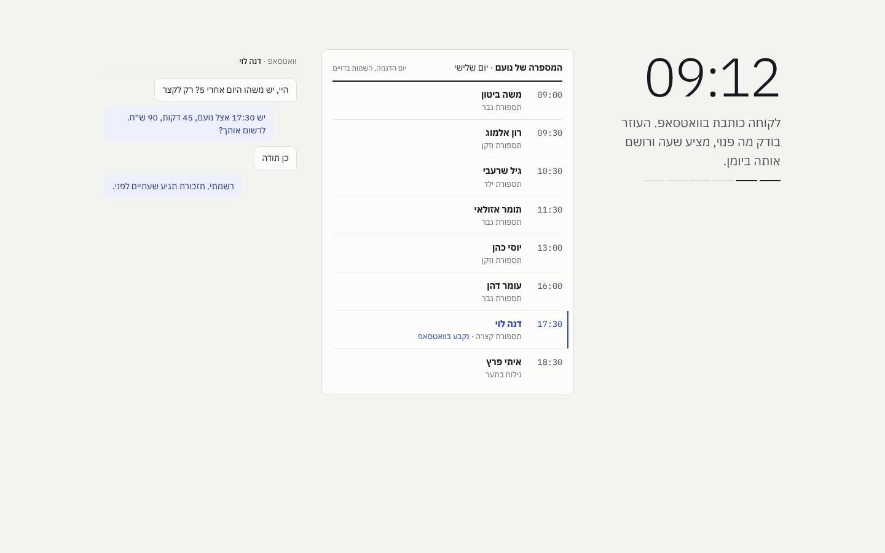
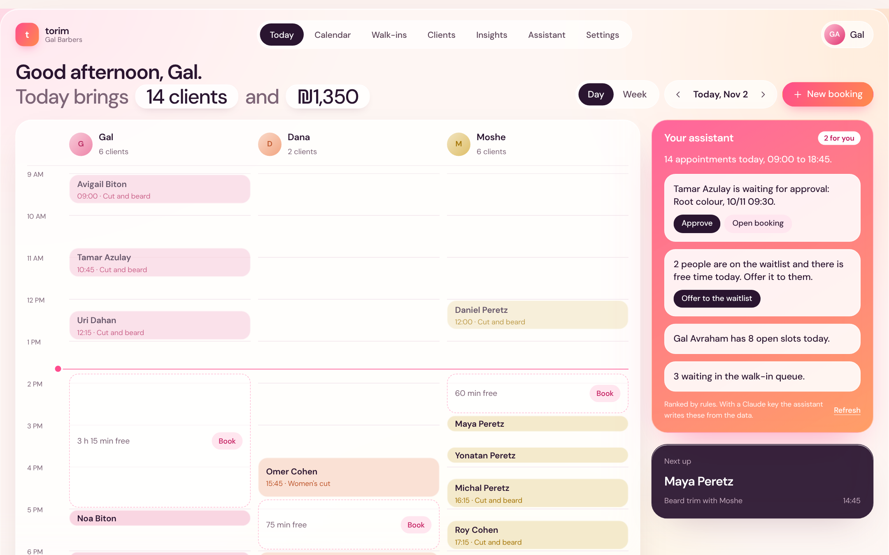
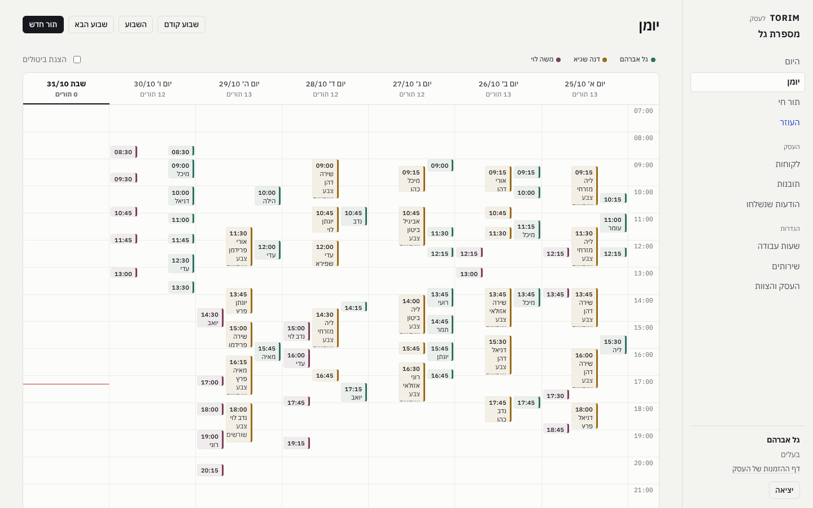
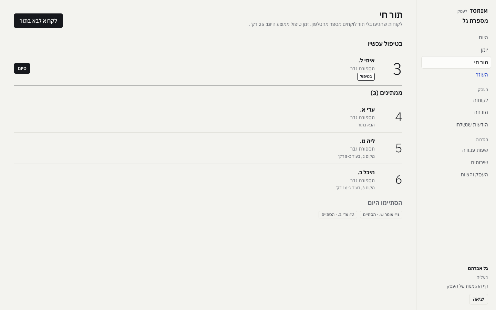
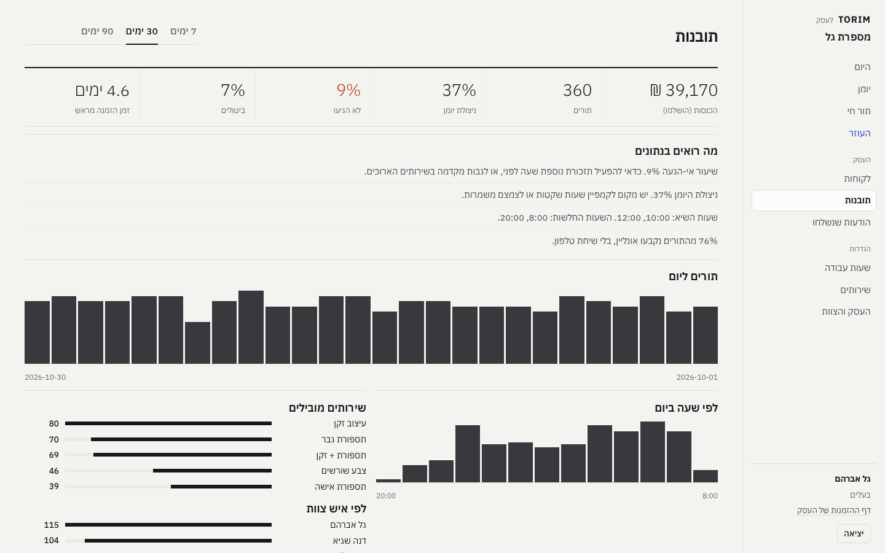
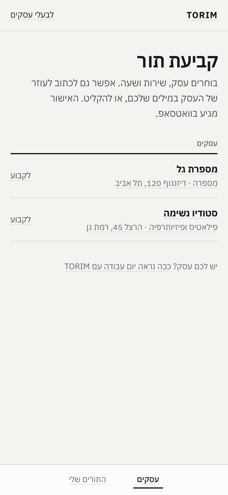
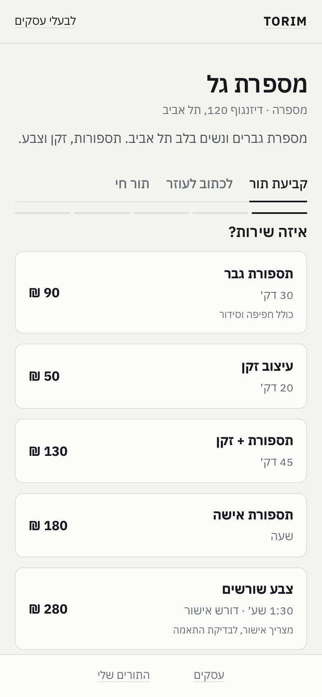
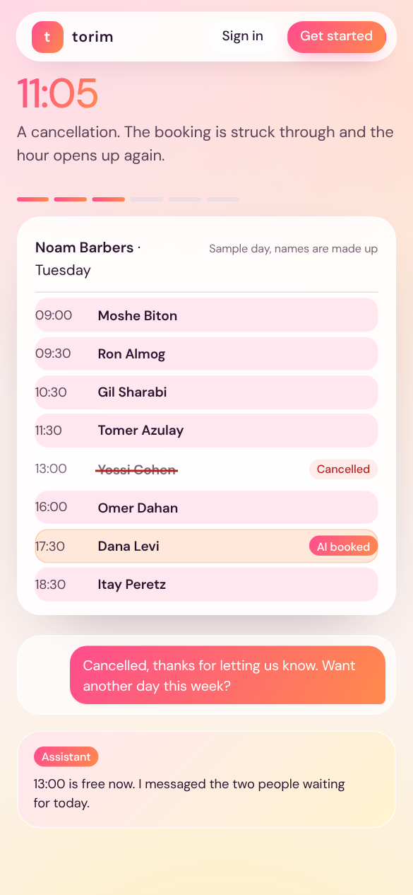

# TORIM: booking calendar with an assistant that books for you

TORIM is a full-stack booking system for small service businesses (barbers,
clinics, studios), built around one idea: an assistant that answers
customers and keeps the calendar, while the owner can always see what it did.
Anything the assistant did, a booking, a note, a drafted message, carries an
"AI booked" mark in the sunset gradient. Everything else was done by people.

Two apps share one API:

- **Client app** (mobile-first PWA): pick a service, a staff member or "first
  available", a day and a time, and book in under a minute. Or write to the
  business's assistant in plain language, by keyboard or by voice. Manage,
  reschedule or cancel from a link, join a waitlist, take a live number for walk-ins.
- **Provider app** (desktop + mobile PWA): a day calendar with a column per
  staff member and the assistant beside it, a week calendar, approvals, walk-in
  queue, customers, hours, services, staff, insights and the message log.

English interface, `Asia/Jerusalem` with correct daylight-saving handling. Phone numbers instead of email, WhatsApp instead of
inboxes, walk-ins next to appointments.



## What the assistant does

All agents run on `claude-opus-5-5` with adaptive thinking, prompt caching and
server-side fallback. Structured outputs use strict JSON schemas, and every
action goes through the same booking engine as the UI.

| | |
|---|---|
| **Sets up the business** | The owner describes the business in a sentence or two. The assistant writes the services, durations, prices, weekly hours and a public description, which carry straight into signup for review. Falls back to category templates without a key. |
| **Answers customers** | Books, moves and cancels in a natural conversation, in the customer's language on the web chat or WhatsApp/Telegram (inbound webhook), scoped to the verified phone number. |
| **Leaves notes on today's page** | Reads the day (risks, pending approvals, waitlist, free time, walk-ins) and writes a short briefing, each note with one action: draft a reminder, approve, offer free time to the waitlist, open the booking. Rule-based notes without a key. |
| **Drafts personal reminders** | For a customer likely to miss, it writes a warm WhatsApp message that fits their history. The owner edits and sends; nothing personal goes out unseen. |
| **Works for the owner** | "Who is likely to no-show this week?", "Block tomorrow 14:00-16:00 and offer the gap to the waitlist": answers from live data and acts in the calendar within owner/staff permissions. |
| **Predicts no-shows** | Per-business logistic regression on the business's own history, with calibrated probabilities and reasons. Runs without a key. |

The agents need `ANTHROPIC_API_KEY`; the booking engine, the no-show model,
rule-based notes and setup templates all work without it.

| Provider app | |
|---|---|
|  |  |
|  |  |

| Client app | | Public page, mobile |
|---|---|---|
|  |  |  |

More in [docs/screenshots](docs/screenshots). Design decisions and their reasons
are in [docs/DESIGN.md](docs/DESIGN.md).

## Features

**Booking engine**
- Weekly hours with breaks, per-date overrides (holiday eve, day off), time off ranges
- Service rules: duration, buffer before/after, minimum notice, booking horizon, group seats, manual approval
- "First available" assigns the least-loaded free staff member
- Slot holds (7 minutes, with countdown) so two people never fill in the form for the same time
- Race-safe booking: 8 concurrent requests for one slot, exactly one succeeds (tested)

**Customer experience**
- Booking wizard, add-to-calendar (.ics), manage link with cancel/reschedule and a cancellation window
- Phone + one-time code sign-in to see all bookings and history
- Waitlist: a cancellation notifies the people waiting for that day, in order
- Walk-in queue: take a number from the phone, live position and ETA, notified when called

**Business side**
- Agenda with "now" line, pending approvals, one-tap arrived / no-show / cancel
- Week calendar with a fixed lane per staff member, filters, double-click to book
- Staff management: invite staff, assign services, copy the owner's hours
- Self-service signup with an assistant-written proposal
- Customer list with visits, no-shows, spend, "regular" and "risk" tags
- Owner vs staff permissions
- Insights: revenue, utilization, no-show and cancel rates, lead time, peak hours, top services, staff load, and plain-language recommendations
- Notification outbox: confirmation, 24h and 2h reminders, waitlist offers, queue calls; console or webhook channel (WhatsApp Business API / Telegram / n8n)

## Architecture

```
apps/client     React + TypeScript + Vite  (served at /)
apps/provider   React + TypeScript + Vite  (served at /pro)
apps/shared     API client, types, formatting, design system CSS
backend/torim
  availability.py   pure slot engine (interval algebra, timezone aware)
  booking.py        holds, lifecycle, waitlist, walk-in queue, concurrency guard
  notifications.py  transactional outbox, templates, channel adapters
  ai/engine.py      agent loop on the Anthropic Messages API (tools, fallback, append-only history)
  ai/receptionist.py customer agent (web chat + WhatsApp/Telegram webhook)
  ai/copilot.py     owner/staff agent over live data and calendar actions
  ai/briefing.py    daily margin notes and personal reminder drafts (structured output)
  ai/setup.py       business setup from a free-text description (structured output)
  ai/risk.py        no-show prediction model
  models.py         SQLAlchemy 2 models (SQLite by default, Postgres ready)
  api/public.py     customer API
  api/provider.py   provider API (auth, agenda, schedule, services, stats)
  api/business.py   signup, business settings, staff
  api/ai.py         briefing, reminders, waitlist offers
  seed.py           2 demo businesses, staff, ~6 weeks of bookings
```

Booking state machine: `pending → confirmed → completed | no_show`, and
`pending | confirmed → cancelled`. Every transition writes its notifications
in the same transaction.

## Run it

```bash
make install        # python venv + npm install
make dev-api        # API on :8000, seeds demo data on first start
make dev-client     # client app on :5173
make dev-provider   # provider app on :5174/pro/
make test           # 36 backend tests (incl. agent loops with a scripted client) + typecheck
```

Or everything together (app plus PostgreSQL): `docker compose up --build`, then open
http://localhost:8000 (client) and http://localhost:8000/pro (provider).

Demo logins (password `demo1234`): `owner@barber.demo` (owner),
`dana@barber.demo` (staff), `owner@studio.demo` (pilates studio with group
classes). In demo mode the phone sign-in code is shown on screen.

Set `ANTHROPIC_API_KEY` to turn the assistant on (without it, booking, queue and
the provider app work, and the assistant tab says it is off). The database is
selected with `TORIM_DATABASE_URL`: SQLite by default for local development,
PostgreSQL in `compose.yaml`.

API docs: http://localhost:8000/docs

## Configuration

| Variable | Default | Purpose |
|---|---|---|
| `TORIM_DATABASE_URL` | `sqlite:///./torim.db` | Any SQLAlchemy URL |
| `TORIM_SECRET` | dev value | Token signing key |
| `TORIM_SEED` | `0` | `1` seeds demo data when the DB is empty |
| `TORIM_CHANNEL` | `console` | `webhook` posts each message as JSON |
| `TORIM_WEBHOOK_URL` | | Target for the webhook channel |
| `TORIM_PUBLIC_URL` | `http://localhost:5173` | Used in links inside messages |
| `TORIM_DEV_OTP` | `1` | Return the sign-in code in the API response (demo only) |
| `ANTHROPIC_API_KEY` | | Enables the assistant (setup, customer chat, notes, reminders, owner chat) |
| `TORIM_AI_MODEL` | `claude-opus-5-5` | Model for every assistant feature |
| `TORIM_WEBHOOK_SECRET` | | Shared secret for `POST /api/webhooks/inbound` (header `X-Torim-Webhook-Secret`) |
