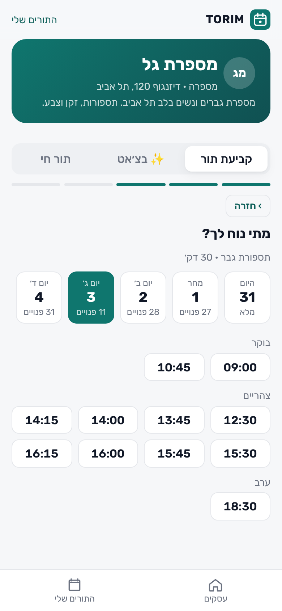
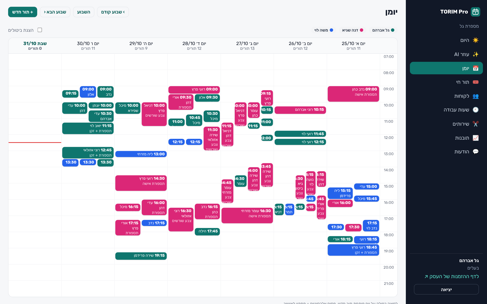
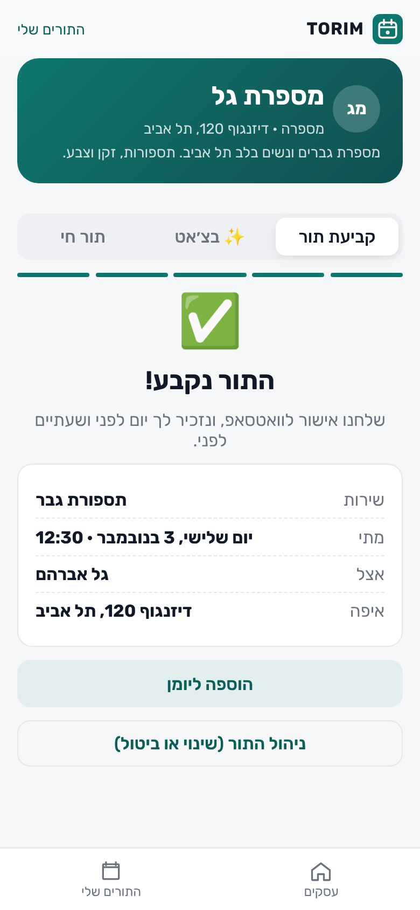
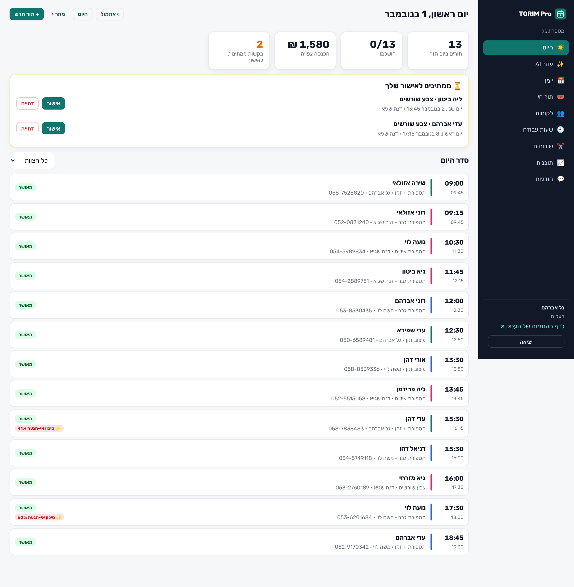

# TORIM: AI-native appointment booking and queue management

An AI-native, full-stack booking system for small service businesses (barbers, clinics,
studios), with **two apps**:

- **Client app** (mobile-first PWA): pick a service, a staff member or "first
  available", a day and a time, and book in under a minute. Manage, reschedule
  or cancel from a link; join a waitlist when a day is full; take a live
  number for walk-ins.
- **Provider app** (TORIM Pro, desktop + mobile PWA): today's agenda,
  weekly calendar, approvals, walk-in queue control, customer history,
  working hours / days off / vacations, service settings, business insights
  and the automated WhatsApp message log.

Hebrew, right-to-left, Israeli week (Sunday first), `Asia/Jerusalem` with
correct daylight-saving handling.

Designed for how local service businesses actually work: phone numbers
instead of email, WhatsApp instead of inboxes, walk-ins next to appointments,
and owners who want numbers they can act on.

## AI-native

| | |
|---|---|
| ✨ **AI receptionist** | Customers book, move and cancel in a natural Hebrew conversation, on the web chat or WhatsApp/Telegram (generic inbound webhook). A Claude Opus 5.5 agent with booking tools, running through the same engine as the UI, scoped to the verified phone number. |
| ✨ **Owner copilot** | "Who is likely to no-show this week?", "How did October compare to September?", "Block tomorrow 14:00-16:00": answers from live data and acts in the calendar, within owner/staff permissions. |
| ✨ **No-show prediction** | Per-business logistic regression on the business's own history, with calibrated probabilities and reasons, shown on the agenda. Works offline. |

The agents need `ANTHROPIC_API_KEY`; everything else (including the no-show
model) runs without it, and the UI says so when the key is missing.

| Client app | Provider app |
|---|---|
|  |  |
|  |  |

More in [docs/screenshots](docs/screenshots).

## Features

**Booking engine**
- Weekly hours with breaks, per-date overrides (holiday eve, day off), time off ranges
- Service rules: duration, buffer before/after, minimum notice, booking horizon, group seats, manual approval
- "First available" assigns the least-loaded free staff member
- Slot holds (7 minutes, with countdown) so two people never fill in the form for the same time
- Race-safe booking: 8 concurrent requests for one slot, exactly one succeeds (tested)

**Customer experience**
- Booking wizard, add-to-calendar (.ics), manage link with cancel/reschedule and a cancellation window
- Phone + one-time code sign-in to see all bookings and history
- Waitlist: a cancellation notifies the people waiting for that day, in order
- Walk-in queue: take a number from the phone, live position and ETA, notified when called

**Business side**
- Agenda with "now" line, pending approvals, one-tap arrived / no-show / cancel
- Week calendar with staff colors, overlapping lanes, filters, double-click to book
- Customer list with visits, no-shows, spend, "regular" and "risk" tags
- Owner vs staff permissions
- Insights: revenue, utilization, no-show and cancel rates, lead time, peak hours, top services, staff load, and plain-language recommendations
- Notification outbox: confirmation, 24h and 2h reminders, waitlist offers, queue calls; console or webhook channel (WhatsApp Business API / Telegram / n8n)

## Architecture

```
apps/client     React + TypeScript + Vite  (served at /)
apps/provider   React + TypeScript + Vite  (served at /pro)
apps/shared     API client, types, Hebrew formatting, design system CSS
backend/torim
  availability.py   pure slot engine (interval algebra, timezone aware)
  booking.py        holds, lifecycle, waitlist, walk-in queue, concurrency guard
  notifications.py  transactional outbox, templates, channel adapters
  ai/engine.py      agent loop on the Anthropic Messages API (tools, fallback, append-only history)
  ai/receptionist.py customer agent (web chat + WhatsApp/Telegram webhook)
  ai/copilot.py     owner/staff agent over live data and calendar actions
  ai/risk.py        no-show prediction model
  models.py         SQLAlchemy 2 models (SQLite by default, Postgres ready)
  api/public.py     customer API
  api/provider.py   provider API (auth, agenda, schedule, services, stats)
  seed.py           2 demo businesses, staff, ~6 weeks of bookings
```

Booking state machine: `pending → confirmed → completed | no_show`, and
`pending | confirmed → cancelled`. Every transition writes its notifications
in the same transaction.

## Run it

```bash
make install        # python venv + npm install
make dev-api        # API on :8000, seeds demo data on first start
make dev-client     # client app on :5173
make dev-provider   # provider app on :5174/pro/
make test           # 28 backend tests (incl. agent loop with a scripted client) + typecheck
```

Or everything in one container: `docker compose up --build`, then open
http://localhost:8000 (client) and http://localhost:8000/pro (provider).

Demo logins (password `demo1234`): `owner@barber.demo` (owner),
`dana@barber.demo` (staff), `owner@studio.demo` (pilates studio with group
classes). In demo mode the phone sign-in code is shown on screen.

API docs: http://localhost:8000/docs

## Configuration

| Variable | Default | Purpose |
|---|---|---|
| `TORIM_DATABASE_URL` | `sqlite:///./torim.db` | Any SQLAlchemy URL |
| `TORIM_SECRET` | dev value | Token signing key |
| `TORIM_SEED` | `0` | `1` seeds demo data when the DB is empty |
| `TORIM_CHANNEL` | `console` | `webhook` posts each message as JSON |
| `TORIM_WEBHOOK_URL` | | Target for the webhook channel |
| `TORIM_PUBLIC_URL` | `http://localhost:5173` | Used in links inside messages |
| `TORIM_DEV_OTP` | `1` | Return the sign-in code in the API response (demo only) |
| `ANTHROPIC_API_KEY` | | Enables the AI receptionist and copilot |
| `TORIM_AI_MODEL` | `claude-opus-5-5` | Model for both agents |
| `TORIM_WEBHOOK_SECRET` | | Shared secret for `POST /api/webhooks/inbound` (header `X-Torim-Webhook-Secret`) |
